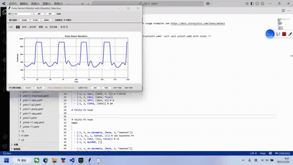

# FocusPulse

Real-time **focus / attention detection from heart rate**, using a Pulse Sensor + Arduino for acquisition and a Python + scikit-learn pipeline for classification.

> ⚠️ **Proof-of-concept status.** The signal acquisition and real-time GUI are real; the attention classifier is currently trained on synthetic data and only performs slightly above random. See [Model evaluation](#model-evaluation) and [Limitations](#limitations).

## Demo



## What it does

1. **Arduino + Pulse Sensor** samples the raw pulse waveform (2 ms interrupt sampling).
2. The Arduino sends **BPM** to a Python app over serial.
3. Python extracts **8 HRV features** from a 50-point sliding window.
4. A **k-NN classifier** predicts `focused` vs `unfocused`.
5. A live **GUI** shows the waveform + attention state; reports export to **HTML/PDF**.

## Architecture

```
[Pulse Sensor] --analog--> [Arduino] --serial--> [Python GUI]
                                                      |
                                               feature extraction
                                               (8 HRV features)
                                                      |
                                                KNN classifier
                                                      |
                                             focus report (HTML/PDF)
```

## Repository layout

- `attention_analyzer.py` — feature extraction, KNN prediction, report generation
- `pulse_sensor_gui.py` — real-time GUI (tkinter + matplotlib)
- `attention_application.py` — application layer
- `generate_test_model.py` — train the KNN model from `attention_learning_data.csv`
- `test_application.py` — end-to-end run on `test_bpm_data.csv`
- `evaluate_model.py` — cross-validation + baseline comparison for the model
- `attention_learning_data.csv` / `test_bpm_data.csv` — sample (synthetic) data
- `attention_model.joblib` — trained KNN model
- `attention_report.html` / `heart_rate_chart.png` — example outputs
- `hardware/` — Arduino sketch (based on PulseSensor Amped)
- `docs/` — demo media

## Quick start

1. Install Python 3.11+.
2. Install dependencies:

   ```bash
   pip install -r requirements.txt
   ```

3. Train the model (uses the bundled sample data):

   ```bash
   python generate_test_model.py
   ```

4. Run an end-to-end test prediction:

   ```bash
   python test_application.py
   ```

5. (With hardware connected) run the live GUI:

   ```bash
   python pulse_sensor_gui.py
   ```

## Hardware

- Arduino (Uno / Nano) + Pulse Sensor
- Pulse Sensor purple wire → analog pin **A0**
- See [`hardware/README.md`](hardware/README.md) for the sketch and wiring.

## Model evaluation

Run:

```bash
python evaluate_model.py
```

Current results on the bundled **synthetic** training set (59 samples, 5-fold stratified CV):

| Metric | Value |
| --- | --- |
| KNN(k=5) accuracy | **0.645** ± 0.076 |
| Random baseline (stratified) | 0.592 ± 0.085 |
| Majority-class baseline | 0.526 |

> **Honest takeaway:** the model performs only slightly above random guessing (~64% vs ~59%), which confirms the synthetic data carries little real signal. Next step: collect **real labeled data** and re-evaluate.

## Limitations (honest)

- Training data is **synthetic** (generated), not collected from real subjects.
- Only ~60 training samples; 5-fold CV accuracy ≈ 64% (barely above random), so the model is not yet meaningful.
- "Attention" is inferred from HRV features only — **not clinically validated**.
- Next steps: collect real labeled data, re-evaluate, and define a validation protocol.

## License

MIT. The Arduino sketch in `hardware/` is based on the open-source [PulseSensor Amped](https://github.com/WorldFamousElectronics/PulseSensor_Amped_Arduino) code and retains its own upstream license.
